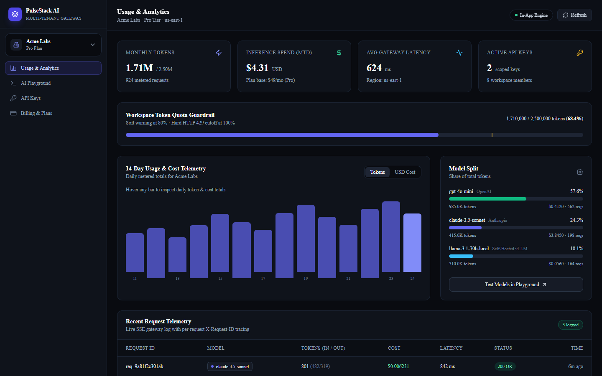
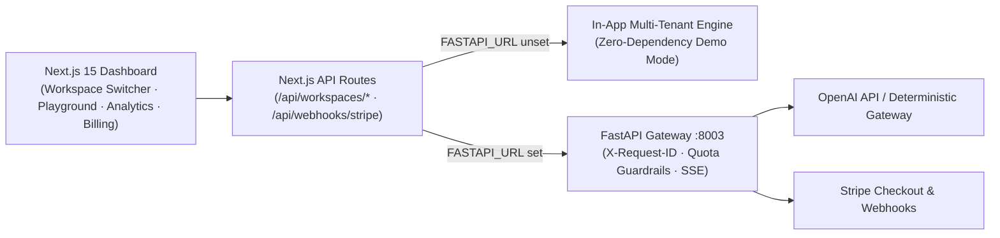

# PulseStack AI — Multi-Tenant AI Workspace SaaS

**Live Demo:** https://pulsestack-ai-demo.netlify.app

A production-oriented multi-tenant AI SaaS platform featuring a **Streaming SSE AI Playground**, **Real-Time Token & Cost Metering**, **Scoped API Key Management**, and **Stripe Subscription Billing & Webhooks**.

Built with **Next.js 15 (App Router, React 19, TypeScript, Tailwind CSS)** and **Python FastAPI (Pydantic v2)**. Deploying `frontend/` standalone to Vercel works out of the box via a built-in multi-tenant metering & streaming engine, or connects seamlessly to the FastAPI gateway when `FASTAPI_URL` is configured.



## Architecture



## Key Features

- **Multi-Tenant Workspace Switcher:** Switch live between seeded organizations (*Acme Labs — Pro*, *Orbit Health — Enterprise*, *Solo Dev — Free*) to inspect isolated quotas, 14-day analytics, API keys, and billing state.
- **Streaming AI Playground (SSE):** Select `gpt-4o-mini`, `claude-3.5-sonnet`, or `llama-3.1-70b-local`, tune temperature, stream token-by-token responses with `X-Request-ID` tracing, latency, prompt/completion tokens, and USD cost — updating the workspace's usage meter immediately.
- **Usage & Cost Analytics:** 14-day interactive token/cost bar chart, model split breakdown, soft (80%) & hard (100% / HTTP `429`) quota guardrails, and live request telemetry table.
- **Scoped API Key Management:** Generate `ps_live_...` keys with one-time secret reveal, granular scopes (`chat:write`, `usage:read`, `billing:read`), last-used timestamps, and instant revocation.
- **Billing & Stripe Subscriptions:** Compare `Free ($0)`, `Pro ($49/mo)`, and `Enterprise ($249/mo)` plans. Wires to real Stripe Checkout when `STRIPE_SECRET_KEY` is present, or runs an interactive simulated Checkout + `checkout.session.completed` webhook flow in Demo Mode with invoice history.

## Local Setup

### Option 1: Docker Compose (Full Stack)

```bash
cp .env.example .env
docker compose up --build
```

- Frontend: `http://localhost:3003`
- FastAPI Backend: `http://localhost:8003` (Docs: `http://localhost:8003/docs`)

### Option 2: Run Locally Without Docker

**Backend (FastAPI on port 8003):**
```bash
cd backend
pip install -r requirements.txt
uvicorn main:app --host 0.0.0.0 --port 8003 --reload
```

**Frontend (Next.js on port 3003):**
```bash
cd frontend
npm install
npm run dev
```

*(Set `FASTAPI_URL=http://localhost:8003` in `frontend/.env.local` to proxy to FastAPI, or leave unset to use the in-app engine.)*

## API Reference (FastAPI Gateway)

All JSON responses use a unified envelope (`request_id`, `timestamp`, `data`) and return an `X-Request-ID` header.

| Method | Endpoint | Description |
|---|---|---|
| `GET` | `/health` | Service health & integration status |
| `GET` | `/api/v1/workspaces` | List workspaces, model catalog, and plans |
| `POST` | `/api/v1/workspaces/{id}/chat/stream` | SSE streaming completion with token/cost metering & HTTP `429` quota enforcement |
| `GET` | `/api/v1/workspaces/{id}/usage` | 14-day usage series, model split, quota status, telemetry & invoices |
| `GET` | `/api/v1/workspaces/{id}/api-keys` | List workspace API keys |
| `POST` | `/api/v1/workspaces/{id}/api-keys` | Create scoped `ps_live_...` API key (one-time secret) |
| `DELETE` | `/api/v1/workspaces/{id}/api-keys/{key_id}` | Revoke an active API key |
| `POST` | `/api/v1/workspaces/{id}/billing/checkout` | Start Stripe Checkout (or Demo Checkout session) |
| `POST` | `/api/v1/webhooks/stripe` | Handle `checkout.session.completed` plan & quota updates |

## Testing

```bash
cd backend
pytest -v
```
